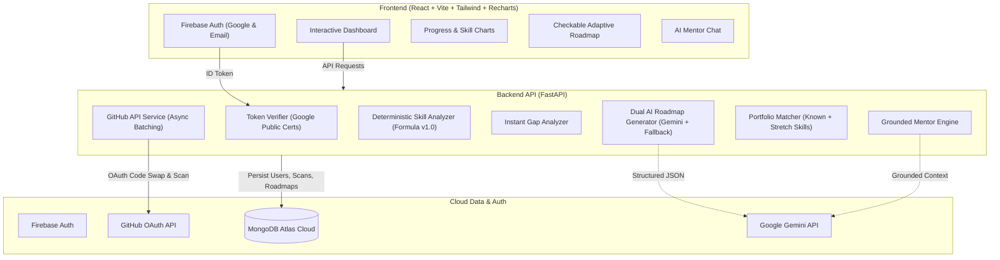

<<<<<<< HEAD
# SkillForge AI

> **A GitHub-verified AI learning mentor that turns real coding activity into an evidence-based, personalized skill roadmap.**

---

## ⚡ What it does

SkillForge AI reads your GitHub activity — repositories, languages, and commit history — to build an objective, verified picture of what you can actually build. It compares your skills against the requirements of a chosen career path (e.g., AI/ML Engineer, Full-Stack Developer), identifies your exact skill gaps, and generates an adaptive week-by-week learning roadmap with free resources, matched portfolio projects, and a grounded AI mentor.

---

## 🏗️ Architecture & Data Pipeline



---

## 🚀 Implemented Phases & Features

| Phase | Spec | Feature | Description |
|---|---|---|---|
| **Phase 0** | Setup | **Walking Skeleton** | React + FastAPI + MongoDB Atlas live infrastructure verification (`/api/health`). |
| **Phase 1** | FR-01 | **Authentication** | Google & Email sign-in via Firebase SDK; JWT verification dependency in FastAPI; user documents in MongoDB. |
| **Phase 2** | FR-02 | **GitHub Integration** | Public-only OAuth flow; Fernet token encryption at rest; async repository & commit analysis. |
| **Phase 3** | FR-03 | **Deterministic Skill Analyzer** | $100 \times (0.35\text{vol} + 0.25\text{brd} + 0.25\text{act} + 0.15\text{rec})$; High/Med/Low confidence; 10-question Cold-Start quiz. |
| **Phase 4** | FR-04 | **Skill Gap Analysis** | Real-time comparison against career profiles (AI Engineer, Full-Stack, Backend); ranked by shortfall $\times$ weight. |
| **Phase 5** | FR-05 | **AI Learning Roadmap** | Dual-engine week-by-week plan generator (Gemini API + rule-based fallback); interactive task checklist. |
| **Phase 6** | FR-06 | **Resource Recommendation** | Curated 100% free learning resources (Docs, Videos, Courses); link health validator script; helpfulness voting. |
| **Phase 7** | FR-07 | **Project Matcher** | Portfolio projects matched to current skills + 1-2 stretch skills; In Progress and Completed status tracking. |
| **Phase 8** | FR-08 | **Progress Dashboard** | Unified aggregate endpoint (`/api/progress`); Recharts skill bars, language donut charts, and readiness dials. |
| **Phase 9** | FR-11 | **Adaptive Loop & Re-scan** | On-demand GitHub re-scanning; before/after score delta badges; historical skill growth line chart. |
| **Phase 10** | FR-09 | **Grounded AI Mentor** | Context-aware chat coaching grounded in verified skills & active roadmap milestones without hallucinations. |
| **Phase 11** | Release | **Harden & Test** | Unit test suite with `pytest`; GDPR-compliant account deletion (`DELETE /api/auth/account`). |

---

## 🛠️ Tech Stack

- **Frontend**: React 19, Vite, Tailwind CSS, Recharts
- **Backend**: FastAPI, Uvicorn, Pydantic v2, HTTPX, Cryptography (Fernet)
- **Database**: MongoDB Atlas (Async Motor driver)
- **Auth**: Firebase Authentication (ID Token verification)
- **AI**: Google Gemini API (`gemini-1.5-flash`)
- **Testing**: Pytest

---

## 🏃 Quick Start Guide

### 1. Backend Setup

```powershell
cd backend
.\venv\Scripts\activate
pip install -r requirements.txt
python run.py
```
> Server runs at `http://localhost:8000` (Swagger docs at `http://localhost:8000/docs`).

### 2. Frontend Setup

```powershell
cd frontend
npm install
npm run dev
```
> App runs at `http://localhost:5173`.

### 3. Run Backend Test Suite

```powershell
cd backend
.\venv\Scripts\python.exe -m pytest -v
```

---

## 📄 License

MIT © 2026 SkillForge AI
=======
# SkillForge
SkillForge AI is an AI-powered learning platform designed to help students identify skill gaps, create personalized learning roadmaps, access curated resources, and track their progress. It bridges the gap between academic knowledge and industry requirements, empowering learners to develop relevant skills and become career-ready.
>>>>>>> 8f4fde16a36002bebee7c71d3830ea92ed07915d
